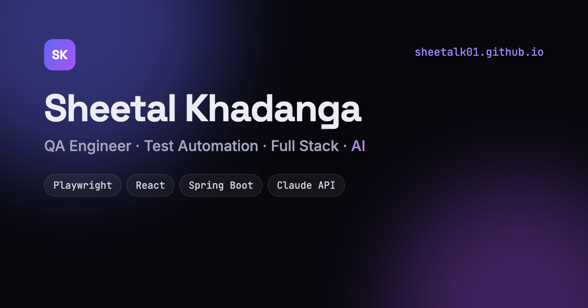

<div align="center">

# Sheetal Khadanga · Portfolio

**QA Engineer · Test Automation · Full Stack · AI**

🌐 **[sheetalk01.github.io](https://sheetalk01.github.io)**



</div>

## About this site

My personal portfolio: experience, projects, skills and education in one place.

- Hand-built with **HTML, CSS and vanilla JavaScript**, with no framework and no build step
- Dark and light themes (remembers your choice, respects your system setting)
- Animated hero terminal that "runs" a Playwright test suite
- **⌘K / Ctrl K** command palette to jump anywhere
- Scroll reveals, count-up stats and a cursor spotlight, all disabled for `prefers-reduced-motion`
- Responsive from 360px phones to wide desktops, keyboard-accessible, with semantic landmarks
- Hosted for free on **GitHub Pages**

## Run locally

```bash
python3 -m http.server 8000
# open http://localhost:8000
```

## Featured project

**[TestPilot AI](https://github.com/SheetalK01/testpilot-ai)**: turns user stories into test cases and
Playwright scripts with Claude. React, Spring Boot, FastAPI, MySQL and 261 automated tests.

## Contact

[LinkedIn](https://www.linkedin.com/in/sheetal-khadanga) · [GitHub](https://github.com/SheetalK01) · [Email](mailto:khadangasheetal@gmail.com)
